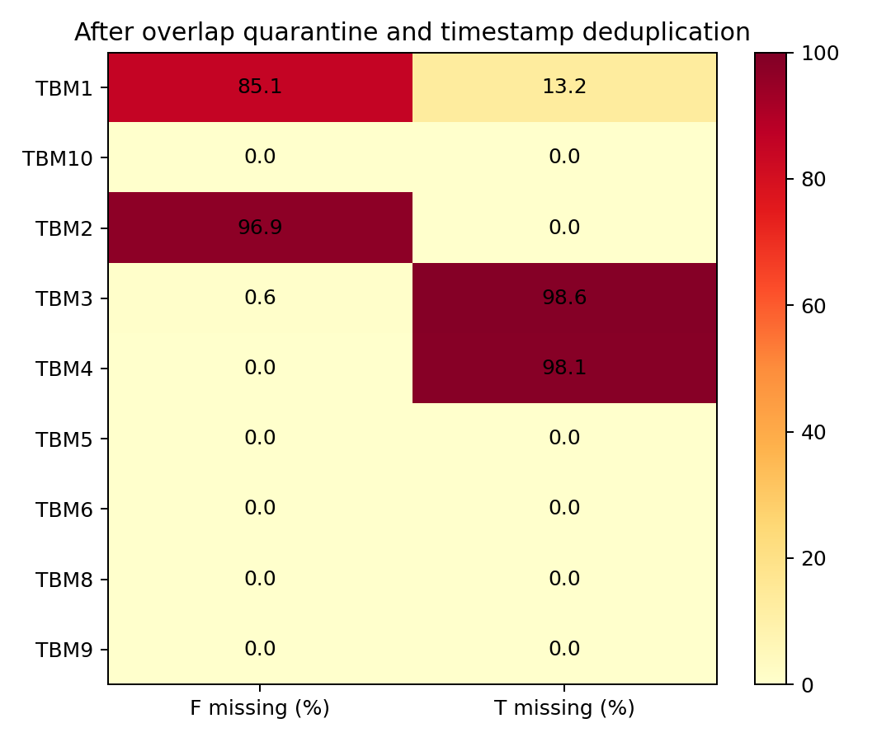
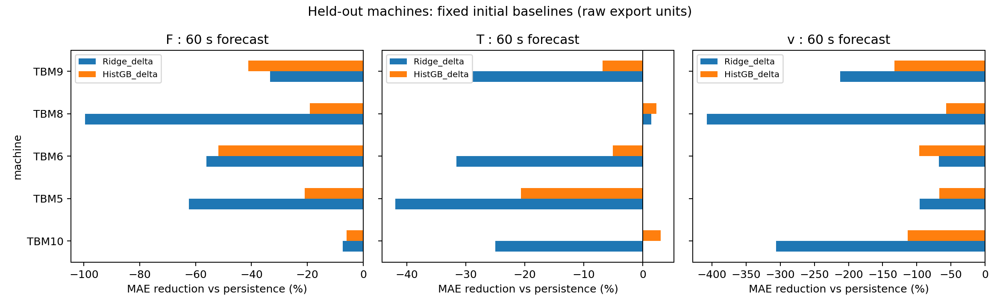

# TBM数据审计与初始预测基线报告

审计日期：2026-10-28（Asia/Shanghai）。范围：当前解压数据目录，原始文件未修改。

## 结论

读取全部 **1,531个原始CSV、7,628,284行、9.284 GB**，覆盖16个目录和9个TBM编号；CSV读取失败0个。
另完整审计Excel **1,035,283行**。9个编号不等于9套已验证独立的数据源：跨编号存在大量逐时刻一致的数据。
隔离210个存在跨机器重合的源文件（双方均隔离），合计1,575,555行；这些文件仍保留在原目录。
同机器按核心信号去重后，剩余6,024,933行供资格审查。
当前能够完成共同时间外推与留一机器评估的是 **TBM10, TBM5, TBM6, TBM8, TBM9**，各时域5台；其余4台缺少足够完整且覆盖训练、验证、测试期的四信号窗口。

固定初始基线未稳定超过持久性。60秒留一机器的HistGB模型，扭矩平均MAE降低率为-5.43%，仅2/5台改善。
负降低率表示模型比持久性更差。这些结果不支持当前简单模型已有迁移优势；也不代表更复杂方法一定无效。

## 原始目录审计

下表在隔离和去重之前统计，缺失包括“文件没有该字段”及“值无法解析”。仅核心字段做全量数值质量审计，辅助传感器仅清点表头。

| 目录 | 行数 | 起始时间 | 结束时间 | 众数间隔/秒 | F缺失 | T缺失 | 四信号为正行数 |
| --- | --- | --- | --- | --- | --- | --- | --- |
| TBM1-2024-色季拉山进口右线 | 161386 | 2024-01-01 00:00:03 | 2024-05-09 21:50:24 | 11.000 | 137317 | 21228 | 73 |
| TBM10-2023-6f-伯舒拉岭左线 | 310967 | 2023-09-13 17:27:00 | 2023-12-30 23:59:50 | 20.000 | 0 | 0 | 84423 |
| TBM10-2024-6f-伯舒拉岭左线 | 693627 | 2024-01-01 00:00:10 | 2024-11-22 23:49:10 | 20.000 | 0 | 0 | 111236 |
| TBM2-2023(good_quality_9s_interval)-色季拉山进口左线 | 406091 | 2023-03-14 08:30:10 | 2023-04-12 23:59:57 | 5.000 | 394453 | 0 | 2253 |
| TBM2-2024-色季拉山进口左线 | 194325 | 2024-04-24 00:00:09 | 2024-05-20 23:59:59 | 10.000 | 0 | 0 | 41751 |
| TBM3-2023-色季拉山出口右线 | 129324 | 2023-10-24 15:39:47 | 2023-12-29 23:59:54 | 31.000 | 3 | 125570 | 1153 |
| TBM3-2024-part1-色季拉山出口右线 | 248787 | 2024-01-01 13:25:14 | 2024-07-05 23:39:41 | 30.000 | 2831 | 246376 | 760 |
| TBM3-2024-part2-色季拉山出口右线 | 67301 | 2024-07-06 00:09:17 | 2024-10-31 18:49:22 | 30.000 | 0 | 67301 | 0 |
| TBM4-2024--色季拉山出口左线 | 49657 | 2023-10-24 15:40:02 | 2023-12-29 23:59:41 | 31.000 | 3 | 48699 | 351 |
| TBM5-2023-孜拉山进口右线 | 1063898 | 2023-04-15 00:00:07 | 2023-12-29 23:59:52 | 10.000 | 2 | 0 | 127421 |
| TBM5-2024-孜拉山进口右线 | 808345 | 2024-01-01 00:00:07 | 2024-06-03 22:36:52 | 10.000 | 0 | 0 | 106720 |
| TBM6-2023-孜拉山进口左线 | 1170209 | 2023-04-14 15:28:51 | 2023-12-29 23:59:50 | 10.000 | 0 | 0 | 167043 |
| TBM6-2024-孜拉山进口左线 | 799718 | 2024-01-01 00:00:07 | 2024-06-03 22:36:52 | 10.000 | 0 | 0 | 105649 |
| TBM8-2024-2f | 287888 | 2024-03-05 15:03:00 | 2024-11-15 07:54:38 | 10.000 | 0 | 0 | 127630 |
| TBM9-2023-6f-伯舒拉岭右线 | 328217 | 2023-09-15 17:03:30 | 2023-12-30 23:59:50 | 20.000 | 0 | 0 | 100752 |
| TBM9-2024-6f-伯舒拉岭右线 | 908544 | 2024-01-01 00:00:10 | 2024-10-28 23:52:50 | 20.000 | 0 | 0 | 167532 |

采样间隔来自真实时间戳，不是文件夹名称。数据含5、10、11、20、30、31秒等采样尺度及长缺口；TBM2的“9s_interval”名称不能替代时间审计。
`file_audit.csv`保存每文件起止时间、倒序、重复、编码、缺失字段、字节数与schema编号；`schemas.json`保存全部表头和映射。

## 数据来源与重复风险

在四个核心信号均为正的观测中，对“时间戳、F、T、n、v”做完全相同值检查，跨机器匹配如下（比例分母为目录有效运行记录）。

| 目录A | 目录B | 相同有效记录 | A有效记录 | B有效记录 | 占A比例 | 占B比例 |
| --- | --- | --- | --- | --- | --- | --- |
| TBM10-2023-6f-伯舒拉岭左线 | TBM9-2023-6f-伯舒拉岭右线 | 1175 | 84423 | 100752 | 0.014 | 0.012 |
| TBM2-2024-色季拉山进口左线 | TBM5-2024-孜拉山进口右线 | 41751 | 41751 | 106720 | 1.000 | 0.391 |
| TBM2-2024-色季拉山进口左线 | TBM6-2024-孜拉山进口左线 | 41751 | 41751 | 105649 | 1.000 | 0.395 |
| TBM5-2024-孜拉山进口右线 | TBM6-2024-孜拉山进口左线 | 105649 | 106720 | 105649 | 0.990 | 1.000 |

TBM2-2024的41,751条有效运行观测全部出现在TBM5/6-2024；TBM6-2024的105,649条有效运行观测全部出现在TBM5-2024。
这说明目录标签与数据独立性尚需核实；无法仅凭这些文件判断哪台设备才是真实来源。
隔离整个相关源文件双方，避免邻近时间窗口仍携带同一序列。对应源文件名与source_id见`file_overlap.csv`与`quarantined_files.csv`。

| directory | files | rows |
| --- | --- | --- |
| TBM10-2023-6f-伯舒拉岭左线 | 2 | 9208 |
| TBM2-2024-色季拉山进口左线 | 26 | 194324 |
| TBM5-2024-孜拉山进口右线 | 90 | 681664 |
| TBM6-2024-孜拉山进口左线 | 90 | 681664 |
| TBM9-2023-6f-伯舒拉岭右线 | 2 | 8695 |

Excel没有机器编号。对其中每10条有效观测取一条，共25,093条作重合检查，24,948条与TBM9目录精确匹配；也有127条与TBM10-2023匹配，其中存在TBM9/10本身重合的记录。
Excel未用作训练或新增机器；少量不匹配记录及其真实来源未完全追溯，不能宣称它是独立外部验证集。
`segmented_cycles_all`、`segmented_cycles_150`、`codes`、`common_using`和zip备份没有计入新增样本。

## 核心字段、单位与清理

F按“总推进力/总推力/推力”映射；T按“刀盘转矩/刀盘扭矩”映射；n优先“刀盘速度”，其次“刀盘实际转速”；v按“推进速度/推进速度(mm/M)”映射。
“刀盘转速”在部分机型上远大于“刀盘速度”，只作辅助核对，未直接替代刀盘速度。p保留用于审计，不作为基线输入或预测标签。
TBM1及TBM2-2023部分导出只有“推进压力”，不以压力替代推力。TBM3和TBM4大量导出缺少总刀盘转矩，不用各电机扭矩随意拼造总扭矩。
`directory_audit.csv`含p*n/v一致性检查与分位数，代数比值接近1只用于口径核对，不能单独确认单位或传感器正确。

用户确认TBM编号对应独立设备；未获得明确设备类型、推力/扭矩/转速单位、刀盘直径、齿轮比及额定载荷表。因此指标采用原始导出数值，无SI转换，无功率/比能特征。
Excel含F最小值-1,168,883、v最大值7,105.389等异常候选；原始CSV数值范围详见审计表。
基线剔除非有限和负的历史/标签观测，不按测试集分位数截尾，也未默默删除所有高值。正值尖峰是否故障需后续设备字典核实。

| 设备 | 原始行数 | 隔离行数 | 冲突时间戳数 | 相同重复行数 | 保留行数 | F缺失 | T缺失 |
| --- | --- | --- | --- | --- | --- | --- | --- |
| TBM1 | 161386 | 0 | 0 | 0 | 161386 | 137317 | 21228 |
| TBM10 | 1004594 | 9208 | 0 | 0 | 995386 | 0 | 0 |
| TBM2 | 600416 | 194324 | 555 | 19664 | 380028 | 368389 | 0 |
| TBM3 | 445412 | 0 | 374 | 984 | 443680 | 2834 | 437515 |
| TBM4 | 49657 | 0 | 0 | 0 | 49657 | 3 | 48699 |
| TBM5 | 1872243 | 681664 | 0 | 0 | 1190579 | 2 | 0 |
| TBM6 | 1969927 | 681664 | 0 | 0 | 1288263 | 0 | 0 |
| TBM8 | 287888 | 0 | 0 | 0 | 287888 | 0 | 0 |
| TBM9 | 1236761 | 8695 | 0 | 0 | 1228066 | 0 | 0 |

“相同重复”按同机器同时间戳四个核心信号相同认定；若任一核心信号冲突，剔除该时间戳所有行。p和其他辅助字段的重复冲突不用于当前四信号预测资格。
TBM1、2、3、4未进入当前比较的具体样本不足原因见`baseline_exclusions.csv`；这不代表这些设备所有数据都不可用，可在来源修复后重新评估。

## 预测任务与防泄漏协议

- 当前及前3次真实观测的F、T、n、v，加历史差分和时间间隔，预测未来F、T、v；不使用未来控制设定、未来转速或同刻贯入代数重构。
- 起点必须处于F、T、n、v均为正的观测状态。未来停机零值纳入标签。因此结论适用于运行起点预测，不能推广到任意停机起点。
- 标签取t+h之后首个真实观测，h为30、60、120秒，最大迟到5秒；实际时域随样本略变，不是严格等间隔标签。
- 不插值，不跨超过60秒缺口、无效观测或不同目录构造窗口。历史是4次观测，物理时间长度随采样间隔而变。
- 每机清理后全部唯一原始时间戳按60%/20%/20%划分；训练目标必须早于训练边界；验证目标必须早于测试边界；跨界窗口剔除。
- 每机训练最多6000窗口、验证和测试各最多10000窗口，种子42；等概率抽取后恢复时间顺序，保留全量窗口缓存。
- 同机器模型仅用该机训练期；留一机器模型仅用其余4台合格机训练期，完全排除目标机拟合数据。两个协议用同一目标机测试窗口。
- 三个模型：Persistence；StandardScaler+Ridge(alpha=100)预测增量；HistGB(80轮、15叶子)预测增量。回归预测限制非负。超参数固定，未用测试结果调参；验证结果另存，未进行模型选择。
- MAE、RMSE、R²按机报告；跨机仅等权汇总相对持久性MAE降低率，避免混合未确认单位的绝对误差。
- 置信区间以预测起点所在的“日”为块重采样1000次；少于5日不报告。区间是每机时间块不确定性，不是对独立机器总体泛化的显著性证明。

分界时间见`split_manifest.csv`。本轮未做预训练、少样本适配、深度模型比较或概率校准，属于数据就绪审计与固定初始基线。

| 设备 | 标称时域/秒 | 实际评估窗口数 | 实际时域中位数/秒 |
| --- | --- | --- | --- |
| TBM10 | 30 | 5817 | 30.000 |
| TBM5 | 30 | 1838 | 30.000 |
| TBM6 | 30 | 2052 | 30.000 |
| TBM8 | 30 | 10000 | 31.000 |
| TBM9 | 30 | 10000 | 30.000 |
| TBM10 | 60 | 10000 | 60.000 |
| TBM5 | 60 | 3089 | 60.000 |
| TBM6 | 60 | 2421 | 60.000 |
| TBM8 | 60 | 10000 | 63.000 |
| TBM9 | 60 | 10000 | 60.000 |
| TBM10 | 120 | 6987 | 120.000 |
| TBM5 | 120 | 2495 | 120.000 |
| TBM6 | 120 | 1963 | 120.000 |
| TBM8 | 120 | 10000 | 125.000 |
| TBM9 | 120 | 10000 | 120.000 |

## 实测结果

下表为测试期各机等权平均，正值优于持久性，负值差于持久性。协议`within_machine`为同机时间外推，`leave_one_machine_out`为留一机器。

| 协议 | 时域/秒 | 模型 | 目标 | 设备数 | 平均MAE降低/% | 优于持久性设备数 |
| --- | --- | --- | --- | --- | --- | --- |
| leave_one_machine_out | 30 | HistGB_delta | F | 5 | -36.268 | 0 |
| leave_one_machine_out | 30 | HistGB_delta | T | 5 | 3.006 | 3 |
| leave_one_machine_out | 30 | HistGB_delta | v | 5 | -79.222 | 0 |
| leave_one_machine_out | 30 | Ridge_delta | F | 5 | -40.449 | 0 |
| leave_one_machine_out | 30 | Ridge_delta | T | 5 | -10.052 | 1 |
| leave_one_machine_out | 30 | Ridge_delta | v | 5 | -275.539 | 0 |
| leave_one_machine_out | 60 | HistGB_delta | F | 5 | -27.796 | 0 |
| leave_one_machine_out | 60 | HistGB_delta | T | 5 | -5.428 | 2 |
| leave_one_machine_out | 60 | HistGB_delta | v | 5 | -93.268 | 0 |
| leave_one_machine_out | 60 | Ridge_delta | F | 5 | -51.782 | 0 |
| leave_one_machine_out | 60 | Ridge_delta | T | 5 | -25.171 | 1 |
| leave_one_machine_out | 60 | Ridge_delta | v | 5 | -217.959 | 0 |
| leave_one_machine_out | 120 | HistGB_delta | F | 5 | -51.571 | 0 |
| leave_one_machine_out | 120 | HistGB_delta | T | 5 | -10.769 | 1 |
| leave_one_machine_out | 120 | HistGB_delta | v | 5 | -176.972 | 0 |
| leave_one_machine_out | 120 | Ridge_delta | F | 5 | -50.196 | 0 |
| leave_one_machine_out | 120 | Ridge_delta | T | 5 | -32.100 | 0 |
| leave_one_machine_out | 120 | Ridge_delta | v | 5 | -176.184 | 0 |
| within_machine | 30 | HistGB_delta | F | 5 | -29.328 | 1 |
| within_machine | 30 | HistGB_delta | T | 5 | -3.398 | 3 |
| within_machine | 30 | HistGB_delta | v | 5 | -86.940 | 1 |
| within_machine | 30 | Ridge_delta | F | 5 | -49.852 | 0 |
| within_machine | 30 | Ridge_delta | T | 5 | -8.575 | 2 |
| within_machine | 30 | Ridge_delta | v | 5 | -269.235 | 1 |
| within_machine | 60 | HistGB_delta | F | 5 | -38.943 | 1 |
| within_machine | 60 | HistGB_delta | T | 5 | -14.573 | 2 |
| within_machine | 60 | HistGB_delta | v | 5 | -150.725 | 1 |
| within_machine | 60 | Ridge_delta | F | 5 | -58.715 | 0 |
| within_machine | 60 | Ridge_delta | T | 5 | -22.814 | 1 |
| within_machine | 60 | Ridge_delta | v | 5 | -158.441 | 1 |
| within_machine | 120 | HistGB_delta | F | 5 | -29.140 | 0 |
| within_machine | 120 | HistGB_delta | T | 5 | -23.691 | 2 |
| within_machine | 120 | HistGB_delta | v | 5 | -388.384 | 1 |
| within_machine | 120 | Ridge_delta | F | 5 | -47.397 | 0 |
| within_machine | 120 | Ridge_delta | T | 5 | -20.836 | 1 |
| within_machine | 120 | Ridge_delta | v | 5 | -153.850 | 1 |

60秒留一机器扭矩MAE明细（原始导出单位）：

| machine | Persistence | Ridge_delta | HistGB_delta | HistGB降低/% | 测试窗口数 | 日块数 | skill区间下限/% | skill区间上限/% |
| --- | --- | --- | --- | --- | --- | --- | --- | --- |
| TBM10 | 348.694 | 435.824 | 338.024 | 3.060 | 10000 | 34.000 | -3.582 | 8.724 |
| TBM5 | 594.367 | 843.754 | 717.115 | -20.652 | 3089 | 24.000 | -54.247 | -10.796 |
| TBM6 | 402.197 | 529.103 | 422.488 | -5.045 | 2421 | 19.000 | -11.752 | 0.407 |
| TBM8 | 355.198 | 350.041 | 346.961 | 2.319 | 10000 | 8.000 | -0.661 | 5.092 |
| TBM9 | 429.466 | 553.176 | 458.763 | -6.822 | 10000 | 59.000 | -17.924 | 0.488 |

全部540条指标（含验证/测试、全部时域和三个目标）见`baseline_metrics.csv`；逐样本真值、预测和实际时域见`predictions/`，模型见`models/`。
不能因秒级相邻样本很多就宣称强统计证据，也不能用部分设备的好结果覆盖其余设备退化。

## 后续研究应先解决的事项

1. 按`quarantined_files.csv`向数据提供方核实TBM2/5/6-2024和TBM9/10-2023的源设备、导出过程及是否误拷贝。在核实前保留当前保守隔离。
2. 补齐设备类型、总推力与油压区别、扭矩与速度单位、齿轮比和列名字典；恢复TBM3/4缺少的刀盘总转矩及TBM1/2缺少的力值。
3. 先解释持续性强、自相关和正值尖峰的影响；在冻结的新验证协议中比较仅历史可用的稳健损失、设备尺度校准与简单适配，保留当前基线作对照。
4. 数据来源可信后再增加自监督快慢状态建模与少样本新机适配。当前结果不足以支撑围岩识别、卡机预警或最优控制结论。

复现入口见上级`README.md`。源文件保持原样，所有隔离均为派生数据筛选，不执行文件搬移或删除。
